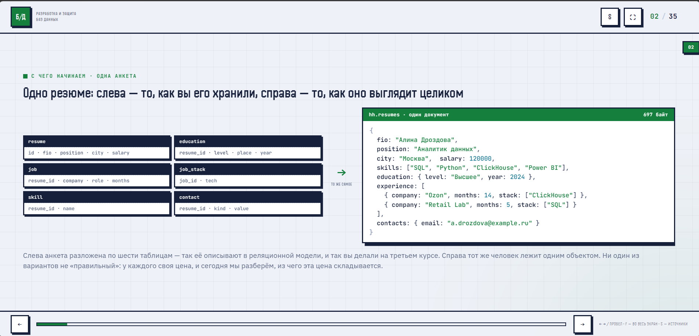
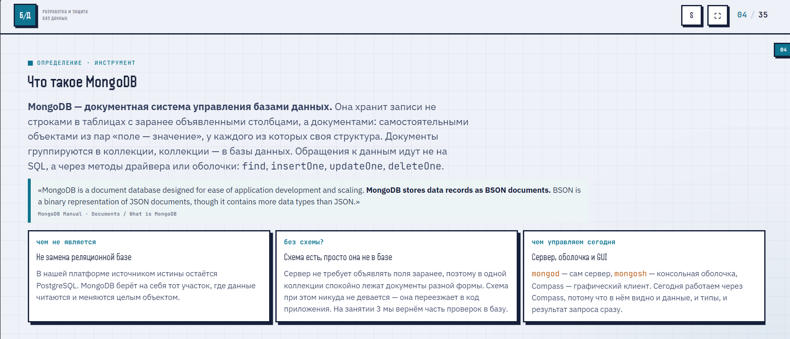
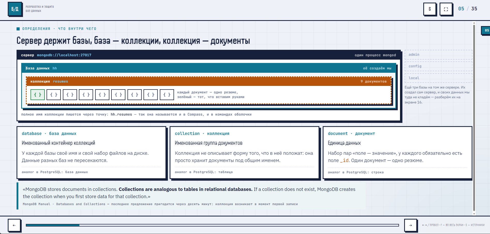
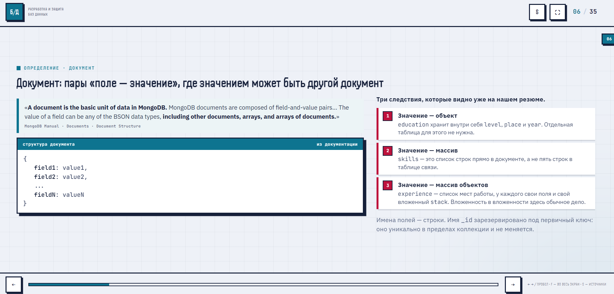
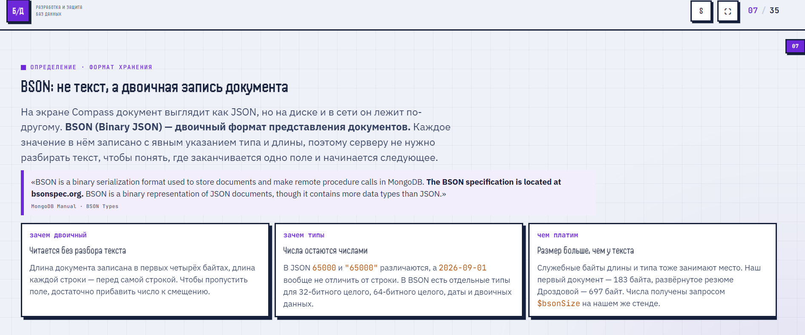

# Конспект по MongoDB

## 1. Определение MongoDB

**MongoDB** — документная система управления базами данных. В отличие от реляционных БД, она хранит записи не в таблицах с заранее объявленными столбцами, а в виде **документов** — самостоятельных объектов из пар «поле — значение».

> *"MongoDB is a document database designed for ease of application development and scaling."*
> — MongoDB Manual


### Ключевые особенности:
- Документы группируются в **коллекции**, коллекции — в **базы данных**.
- Вместо SQL используется собственный язык запросов через методы драйвера или оболочки: `find`, `insertOne`, `updateOne`, `deleteOne`.
- Схема данных не описывается на стороне сервера — она переезжает в код приложения.

---

## 2. Что такое документ



**Документ** — это базовая единица данных в MongoDB. Это набор пар «поле — значение», где значением может быть другой документ, массив или массив документов.

```json
{
    field1: value1,
    field2: value2,
    ...
}
```

### Пример из материалов:
```json
{
  fio: "Алина Дроздова",
  position: "Аналитик данных",
  city: "Москва",
  salary: 120000,
  skills: ["SQL", "Python", "ClickHouse", "Power BI"],
  education: { level: "Высшее", year: 2024 },
  experience: [
    { company: "Ozon", months: 14, stack: ["ClickHouse"] },
    { company: "Retail Lab", months: 5, stack: ["SQL"] }
  ],
  contacts: { email: "a.drozdova@example.ru" }
}
```

### Следствия из структуры документа:
1. **Значение может быть объектом** (`education`) — не нужна отдельная таблица.
2. **Значение может быть массивом** (`skills`) — данные хранятся прямо в документе.
3. **Значение может быть массивом объектов** (`experience`) — поддерживается вложенность любой глубины.
4. Поле `_id` зарезервировано под первичный ключ — оно уникально в пределах коллекции.

---

## 3. Иерархия хранения

```
Сервер (mongod)
   └── База данных (database)
         └── Коллекция (collection)
               └── Документ (document)
```

- **Коллекция** — именованная группа документов. Она не описывает форму данных, которые в неё попадут.
- Если коллекции не существует, MongoDB создаёт её автоматически при первой вставке данных.

---


## 4. BSON — внутренний формат хранения

**BSON (Binary JSON)** — двоичный формат представления документов. В Compass документ выглядит как JSON, но на диске и в сети хранится иначе.

> *"BSON is a binary serialization format used to store documents and make remote procedure calls in MongoDB."*
> — MongoDB Manual


### Зачем нужен двоичный формат?
- **Читается без разбора текста** — длина документа записана в первых 4 байтах.
- **Явные типы данных** — числа остаются числами, даты — датами.
- Чтобы пропустить поле, достаточно прибавить число к смещению.

### Чем платим?
- Размер больше, чем у текстового JSON (служебные байты длины и типа).
- Резюме Дроздовой в BSON занимает **697 байт**.

### Пример байтовой структуры документа `{ n: "Пётр" }` — 21 байт:
```
15 00 00 00 | 02 | 6E 00 | 09 00 00 00 | 9F D1 91 D1 82 D1 80 | 00
```
- **4 байта** — длина документа (0x15 = 21)
- **1 байт** — тип (0x02 = строка)
- **2 байта** — имя поля `n` + нулевой байт
- **13 байт** — значение (длина 9 + строка "Пётр" в UTF-8)
- **1 байт** — нулевой байт-терминатор



---

## 5. Типы BSON

| Тип | ID | Пример в коллекции |
|-----|----|--------------------|
| String | 2 | `fio`, `city`, `position` |
| Object | 3 | `education`, `contacts` |
| Array | 4 | `skills`, `experience` |
| ObjectId | 7 | `_id` |
| Boolean | 8 | `ready_to_move` |
| Date | 9 | `updated` |
| Null | 10 | поле есть, но значения нет |

> **Важно:** от типа зависит сравнение. Запрос `{ salary: { $gt: 100000 } }` найдёт числа и пропустит строку `"120000"`. Это частая причина пустого результата.

---

## 6. Поле `_id` и ObjectId

Если `_id` не передан, сервер или драйвер автоматически генерирует значение типа **ObjectId** — 12 байт с внутренней структурой.

```
6a | 9e | 46 | 7a | 48 | 31 | d3 | c4 | cf | a4 | 20 | 92
```

### Структура ObjectId:
- **4 байта** — время (секунды с 1970 года) → можно узнать момент создания
- **5 байт** — случайное значение, уникальное для процесса
- **3 байта** — счётчик, увеличивается для каждого нового ObjectId

> *"The 12-byte ObjectIds consists of: a 4-byte timestamp... a 5-byte random value... a 3-byte incrementing counter."*
> — MongoDB Manual

### Полезное следствие:
Сортировка по `_id` почти совпадает с сортировкой по времени создания. Но полагаться на это как на точное время не стоит — часы на машине клиента могут отличаться от серверных.

---

## 7. Сервер и клиент

**Важно различать:**
- **Сервер (`mongod`)** — хранит данные, слушает порт 27017.
- **Клиент** — отправляет запросы (Compass, `mongosh` и др.).

Без сервера клиенту не к чему подключаться. Сервер работает и без графического интерфейса.

### Практическая последовательность:
1. Скачать Compass
2. Поднять сервер (`mongo:7` в Docker Compose)
3. Подключиться
4. Создать базу данных
5. Вставить документ
6. Найти документ

---

## 8. Сравнение с реляционной моделью

| Реляционная модель | Документная модель |
|-------------------|-------------------|
| Данные разложены по таблицам | Данные хранятся цельным объектом |
| Схема объявлена заранее | Схема в коде приложения |
| Нормализация | Вложенность и денормализация |
| SQL | Методы драйвера/оболочки |

> Ни один из вариантов не «правильный»: у каждого своя цена и своя область применения.